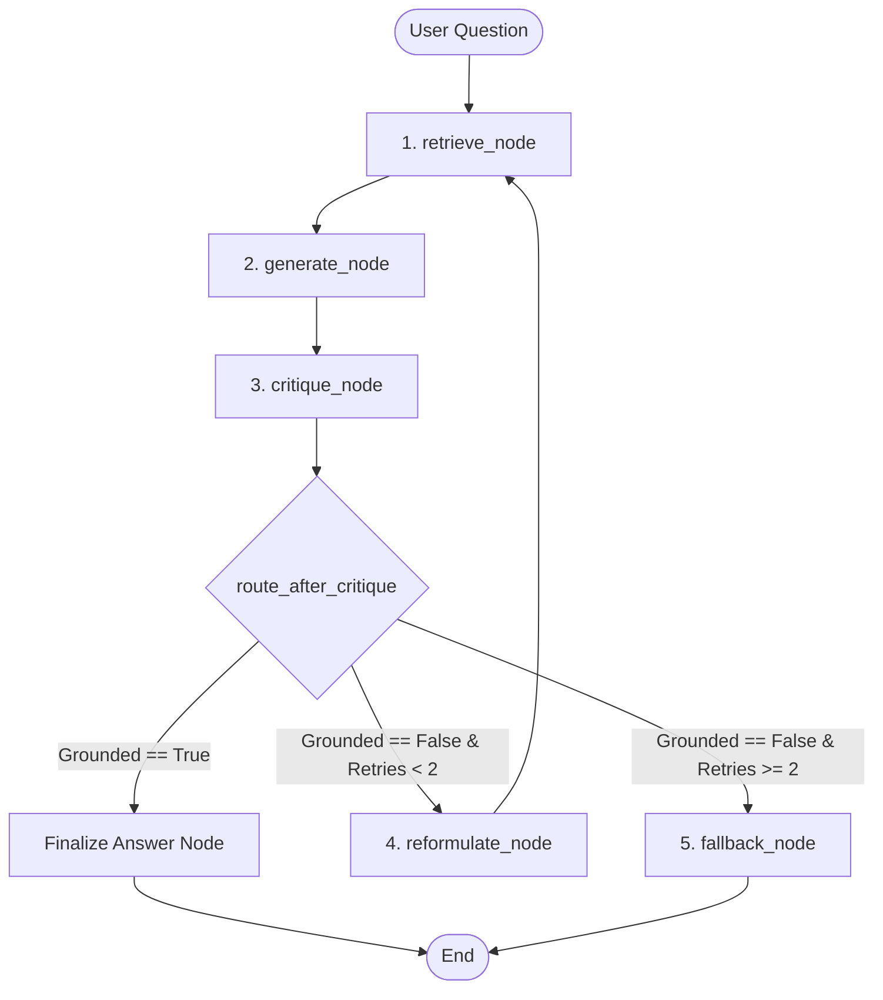

# Self-Healing RAG Pipeline: Project Master Overview

## 📌 Executive Overview
The **Self-Healing RAG Pipeline** is a stateful, agentic Retrieval-Augmented Generation system designed to eliminate LLM hallucinations and ungrounded factual responses. Conventional RAG pipelines operate linearly (Retrieve → Generate) without validating whether generated claims are actually supported by retrieved documents.

This project introduces an **iterative self-healing critique loop** powered by **LangGraph**. An independent LLM Fact-Checker (Critic) evaluates candidate answers using structured JSON schemas. If an answer contains ungrounded claims, the graph dynamically reformulates the search query, re-retrieves context from ChromaDB, and re-generates the answer up to a hard-capped limit of **`max_retries = 2`**. If context remains insufficient, it safely routes to a deterministic fallback response.

---

## 🏛️ System Architecture & Graph Topology



### LangGraph Nodes (`src/nodes.py`)
1. **`retrieve_node`**:
   - Queries ChromaDB for top-4 (`k=4`) document chunks using `reformulated_query` (if retrying) or original `question`.
   - Appends retrieval metadata to `trace_log`.
2. **`generate_node`**:
   - Uses `gpt-4o-mini` with a strict system prompt: *"Answer ONLY using the provided context. If the context does not contain enough information, explicitly say 'I don't have enough information in the provided context.' Do not use outside knowledge."*
3. **`critique_node`**:
   - Independent `gpt-4o-mini` call acting strictly as a fact-checker (distinct prompt from generator).
   - Utilizes `response_format={"type": "json_object"}` to return structured evaluation output.
4. **`reformulate_node`**:
   - Executed when `critique_grounded == False` and `retry_count < max_retries`.
   - Prompts LLM to rewrite search query based on critic reasoning to retrieve better matching documents. Increments `retry_count`.
5. **`fallback_node`**:
   - Executed when retries are exhausted (`retry_count >= max_retries`).
   - Sets `final_response = "I don't have enough information in the available documents to answer this confidently."` without calling LLMs (hardcoded safety net).

---

## 🛡️ Critic Fact-Checker Schema (`critique_node`)

The critic operates under a separate system prompt:
> *"You are a strict fact-checker. Given the retrieved context and the generated answer, determine if EVERY factual claim in the answer is directly supported by the context. Do not be lenient. If the answer contains any claim not in the context, mark grounded=false and list the unsupported claims."*

### Structured JSON Response Format:
```json
{
  "grounded": false,
  "reasoning": "The answer claims remote workers receive 30 vacation days, but the context states full-time employees receive 20 days of Paid Time Off (PTO) annually.",
  "confidence": 0.95,
  "unsupported_claims": ["30 vacation days per year for remote workers"]
}
```

---

## 📊 Large-Scale Vector Database & Ingestion

- **Source Documents**: **183 Markdown & Text Files** stored in `data/source_docs/`.
- **Vector Store**: **754 Chunks** embedded with OpenAI `text-embedding-3-small` in local persistent ChromaDB (`data/chroma_db/`).
- **Chunking Configuration**: `RecursiveCharacterTextSplitter` (500 tokens/characters chunk size, 50 overlap).

### Enterprise Knowledge Base Categories:
1. **Cloud Infra & DevOps**: Kubernetes EKS/GKE, Terraform IaC, HashiCorp Vault, Zero Trust mTLS, Datadog Monitoring, Kafka Streaming, Redis Enterprise, PostgreSQL Tuning, AWS DR, Docker Hardening.
2. **Product & API Specs**: API Gateway, GraphQL Schemas, Python SDK, TypeScript SDK, Webhook Signatures, OAuth 2.0 / OIDC, WebSocket Realtime Protocol, DB Migrations, Feature Flags.
3. **HR & Company Policies**: PTO & Holiday Calendars, Equipment Stipends ($1,500), Business Travel & Meals ($75/day limit), Learning Budgets ($1,000/yr), Parental Leave, Performance Reviews, Stock Options.
4. **Troubleshooting & KB**: ERR-100 to ERR-500 Error Series, P1-P3 Incident Response SLAs, Network Latency, Memory Leaks, SSL Certificate Renewal.
5. **Security & Compliance**: SOC 2 Type II, ISO 27001 ISMS, GDPR DSAR Rights, HIPAA PHI Guidelines, Vulnerability Remediation SLAs.

---

## 💻 Tech Stack & API Reference

### Technology Stack:
- **Language**: Python 3.12+
- **Graph Orchestration**: `langgraph` (StateGraph with conditional cycle)
- **LLMs & Embeddings**: OpenAI `gpt-4o-mini` (Generator & Critic) + `text-embedding-3-small`
- **Vector Store**: Chroma (`chromadb` & `langchain-chroma`)
- **Backend API**: FastAPI (`uvicorn`)
- **Frontend UIs**: Minimal Classy React App (Vite + Lucide Icons) & Streamlit UI
- **Environment Management**: `python-dotenv` with `.env` file

### FastAPI Endpoint (`src/api.py`)

#### `POST /ask`
**Request Payload**:
```json
{
  "question": "What is the equipment stipend for new hires at AcroCorp?",
  "max_retries": 2
}
```

**Response Payload**:
```json
{
  "final_response": "The equipment stipend for new hires is a one-time home office technology stipend of $1,500 USD.",
  "grounded": true,
  "retry_count": 0,
  "trace_log": [
    "🚀 [Start] Processing question: 'What is the equipment stipend for new hires at AcroCorp?' (Max Retries: 2)",
    "🔍 [Retrieve] Retrieved 4 chunks for query: 'What is the equipment stipend for new hires at AcroCorp?'",
    "✍️ [Generate] Generated answer: 'The equipment stipend for new hires is a one-time home office technology stipend of $1,500 USD.'",
    "✅ [Critique] Passed fact-check! Grounded=True (Confidence: 1.00)",
    "🎉 [Finalize] Answer verified as grounded. Setting final response."
  ]
}
```

---

## 🎨 Frontend UI Interfaces

### 1. Minimal Classy React UI (Recommended)
- **URL**: `http://localhost:5173`
- **Features**: Linear/Apple dark minimalist design (`#090D16`), preset query chips across 5 enterprise categories, copy to clipboard, real-time latency metric, color-coded trajectory step nodes.

### 2. Streamlit UI
- **URL**: `http://localhost:8501`
- **Features**: Expandable execution trace log, status badges (`Grounded ✅` / `Fallback 🛑`), sidebar query selectors.

---

## 📈 Evaluation Benchmark Results (`eval/run_eval.py`)

The evaluation suite tests **20 curated QA pairs** (mix of answerable and unanswerable questions) against the compiled state machine.

```
==================================================================================
               SELF-HEALING RAG PIPELINE EVALUATION BENCHMARK                    
==================================================================================
Total Test Cases: 20

ID  | Question                                      | Expected   | Grounded | Retries | Status
----------------------------------------------------------------------------------------------
1   | What is the equipment stipend for new hire... | Answer     | Yes      | 0       | PASS ✅
2   | What is the daily meal reimbursement limit... | Answer     | Yes      | 0       | PASS ✅
3   | How many days of annual PTO do full-time e... | Answer     | Yes      | 0       | PASS ✅
4   | What are the core operating hours for Acro... | Answer     | Yes      | 0       | PASS ✅
5   | What are the API rate limits and execution... | Answer     | Yes      | 0       | PASS ✅
6   | Which deployment regions are supported by ... | Answer     | Yes      | 0       | PASS ✅
7   | How do you resolve error ERR-401 (Authenti... | Answer     | Yes      | 0       | PASS ✅
8   | What is the initial response SLA for P1 Cr... | Answer     | Yes      | 0       | PASS ✅
9   | What is the token validity period and head... | Answer     | Yes      | 0       | PASS ✅
10  | What are the RTO and RPO targets for AWS M... | Answer     | Yes      | 0       | PASS ✅
11  | What trust service criteria are audited un... | Answer     | Yes      | 0       | PASS ✅
12  | What is the timeline for processing GDPR D... | Answer     | Yes      | 0       | PASS ✅
13  | What encryption standards are required for... | Answer     | Yes      | 0       | PASS ✅
14  | What is AcroCorp's parental leave and mate... | Answer     | Yes      | 0       | PASS ✅
15  | Does AcroCorp provide a 401(k) retirement ... | Fallback   | Yes      | 0       | PASS ✅
16  | What are the stock option vesting schedule... | Fallback   | Yes      | 0       | PASS ✅
17  | What is the pricing per hour for NVIDIA H1... | Fallback   | Yes      | 0       | PASS ✅
18  | What dental and vision insurance plans doe... | Fallback   | Yes      | 0       | PASS ✅
19  | How do I request a company car for busines... | Fallback   | Yes      | 0       | PASS ✅
20  | What is the protocol for emergency server ... | Fallback   | Yes      | 0       | PASS ✅
----------------------------------------------------------------------------------------------

==================================================================================
                              EVALUATION SUMMARY                                  
==================================================================================
Total Questions Evaluated:  20
Passed Tests:               20 / 20 (100.0%)
Total Reformulation Retries: 0
Average Retries per Query:   0.00
==================================================================================
```

---

## ⚡ Quick Start & Execution Commands

### 1. Ingest Documents into Vector Database
```bash
python -m src.ingest
```

### 2. Start FastAPI Backend Service
```bash
uvicorn src.api:app --reload --port 8000
```

### 3. Start Minimal Classy React UI
```bash
cd frontend
npm install
npm run dev
```
Open **`http://localhost:5173`** in your web browser.

### 4. Run Evaluation Suite
```bash
python -m eval.run_eval
```

---

## 📂 Complete File Directory Map

```
self-healing-rag/
├── PROJECT_SUMMARY.md       # Master project documentation & specs
├── README.md                # General readme & quickstart guide
├── requirements.txt         # Pinned python dependencies
├── .env.example             # Sample environment variables template
├── .env                     # Active environment configuration with OPENAI_API_KEY
├── .gitignore               # Git ignored rules (data/chroma_db, .env, __pycache__)
├── generate_docs.py         # Batch generator script for 180+ enterprise source documents
├── data/
│   ├── source_docs/         # 183 markdown & text source files
│   └── chroma_db/           # Local persistent Chroma vector database (754 chunks)
├── src/
│   ├── __init__.py          # Package initializer
│   ├── config.py            # Configuration parameters & OpenAI settings
│   ├── ingest.py            # Chunking, OpenAI embedding & Chroma loading logic
│   ├── state.py             # RAGState TypedDict definition
│   ├── nodes.py             # Retrieve, generate, critique, reformulate, fallback node functions
│   ├── graph.py             # StateGraph setup & conditional routing logic
│   └── api.py               # FastAPI service exposing POST /ask
├── frontend/                # Minimal Classy React App (Vite + Lucide Icons)
│   ├── src/
│   │   ├── App.jsx          # React app with preset query chips & execution trajectory
│   │   ├── index.css        # Minimal dark Apple/Linear styling rules
│   │   └── main.jsx         # React DOM entry point
│   └── package.json         # Frontend npm dependencies
├── streamlit_app.py         # Streamlit UI alternative
└── eval/
    ├── golden_qa.json       # 20 curated test Q&A pairs across answerable & fallback scenarios
    └── run_eval.py          # Benchmark runner printing evaluation matrix & summary
```
