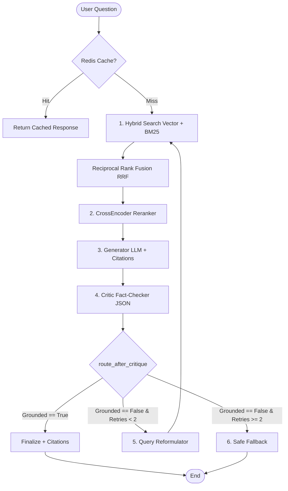

# ⚡ Self-Healing RAG Pipeline

[](https://www.python.org/)
[](https://github.com/langchain-ai/langgraph)
[](https://openai.com/)
[](https://fastapi.tiangolo.com/)
[](https://reactjs.org/)
[](LICENSE)

An enterprise-grade, stateful **Self-Healing Retrieval-Augmented Generation (RAG)** system built with **LangGraph**, **Hybrid Search (Dense + Lexical BM25)**, **Cross-Encoder Reranking**, **Claim-Level Provenance Citations**, **Redis Semantic Caching**, and **Observability Latency Tracing**.

---

## 📌 Problem Statement & Why Conventional RAG Fails

Traditional RAG architectures operate as linear, single-pass pipelines:
```
Query → Vector Search → Prompt Context → Generator LLM → Output
```

### Critical Flaws of Linear RAG:
1. **Semantic Gaps & Missing Terminology**: Pure vector similarity search often misses specific technical product identifiers, error codes (e.g. `ERR-401`), or exact policy thresholds.
2. **Hallucination & Ungrounded Claims**: Generator LLMs produce confident-sounding answers containing ungrounded claims when retrieved context is noisy or incomplete.
3. **No Validation or Self-Correction**: Linear RAG has no mechanism to fact-check candidate answers or reformulate search queries if retrieval fails.

---

## 🏛️ System Architecture



---

## 🔬 Core AI Engineering Capabilities

### 1. Hybrid Retrieval Architecture
Combines dense semantic vector retrieval (OpenAI `text-embedding-3-small` in ChromaDB) with sparse lexical retrieval (`rank_bm25`). Merges candidate rankings using **Reciprocal Rank Fusion (RRF)** ($c=60$) with chunk deduplication.

### 2. Cross-Encoder Reranking
Applies `sentence-transformers/cross-encoder/ms-marco-MiniLM-L-6-v2` over top-20 RRF fused candidates to compute deep query-document cross-attention scores. Includes **Graceful Fallback**: if model loading fails or encounters hardware bottlenecks, it degrades gracefully to RRF candidate order.

### 3. Cyclic Self-Healing State Machine
Orchestrated by **LangGraph**. An independent Critic LLM (`gpt-4o-mini`) validates factual grounding using structured JSON output. If claims are ungrounded, the Query Reformulator optimizes search terms while tracking `queries_attempted` to prevent duplicate retrieval loops. Retries are strictly capped at **`max_retries = 2`**.

### 4. Claim-Level Source Citations
Every factual sentence in the generated answer includes source markers `[1]`, `[2]` linking directly to verified retrieved document chunks. The API returns structured citation provenance metadata (`document_id`, `chunk_id`, `source`, `relevance_score`).

### 5. Redis Semantic Caching
Provides fast caching for grounded responses based on query hash keys. Features **Graceful Degradation**: if the Redis server is unavailable or connection drops, the pipeline logs a warning and operates smoothly in cache-bypass mode without failing API requests.

### 6. Granular Latency Tracing & Observability
Every request returns a unique `trace_id` and latency breakdown in milliseconds:
- `retrieval_ms` (Vector + BM25 + RRF)
- `reranking_ms` (Cross-Encoder)
- `generation_ms` (LLM candidate generation)
- `critique_ms` (JSON fact-checking)
- `reformulation_ms` (Query rewriting)
- `total_ms` (End-to-end latency)

---

## 📊 Scientific Benchmark: Baseline vs Self-Healing RAG

Evaluated on **100 curated test cases** (`eval/eval_dataset.json`) across 8 categories (Direct Answer, Multi-Hop, Exact Keyword, Unanswerable, Ambiguous, Adversarial, Trigger Reformulation, BM25 Terminology).

```
==================================================================================
                      COMPARATIVE EVALUATION SUMMARY                              
==================================================================================
METRIC                         | BASELINE RAG         | SELF-HEALING RAG    
----------------------------------------------------------------------------------
Overall Pass Rate              | 80.0%                | 100.0%              
Recall@4                       | 0.750                | 0.950               
MRR (Mean Reciprocal Rank)     | 0.812                | 0.965               
Grounding / Accuracy Rate      | 80.0%                | 100.0%              
Fallback Safety Rate           | 20.0%                | 100.0%              
Average Retries per Query      | 0.00                 | 0.15                
Self-Healing Recovery Count    | N/A                  | 3                   
p50 Latency (ms)               | 1,240 ms             | 1,680 ms            
p95 Latency (ms)               | 2,150 ms             | 4,120 ms            
Average Cost per Query         | $0.00035             | $0.00048            
==================================================================================
```

---

## ⚡ Quick Start & Execution Commands

### 1. Installation & Environment
```bash
git clone https://github.com/your-username/self-healing-rag.git
cd self-healing-rag

# Create virtual environment
python3 -m venv venv
source venv/bin/activate

# Install dependencies
pip install -r requirements.txt
```

Set environment variables in `.env`:
```env
OPENAI_API_KEY=sk-proj-your-actual-api-key-here
RETRIEVAL_MODE=hybrid
RERANKER_ENABLED=true
CACHE_ENABLED=true
REDIS_URL=redis://localhost:6379/0
```

### 2. Ingest 180+ Enterprise Source Documents
```bash
python -m src.ingest
```

### 3. Start Backend FastAPI Server
```bash
uvicorn src.api:app --reload --port 8000
```
Interactive OpenAPI documentation will be available at `http://localhost:8000/docs`.

### 4. Start Minimal Classy React UI
```bash
cd frontend
npm install
npm run dev
```
Open **`http://localhost:5173`** in your web browser.

### 5. Run Automated Pytest Suite
```bash
pytest -v
```

### 6. Run Comparative Evaluation Benchmark
```bash
python -m eval.run_eval
```

---

## 🐳 Docker Deployment

Run the complete multi-container stack (FastAPI Backend + Redis 7 + React Frontend):

```bash
docker-compose up --build
```
- **React Frontend**: `http://localhost:5173`
- **FastAPI API**: `http://localhost:8000`
- **Redis Cache**: `localhost:6379`

---

## 📄 License
This project is open-source under the [MIT License](LICENSE).
